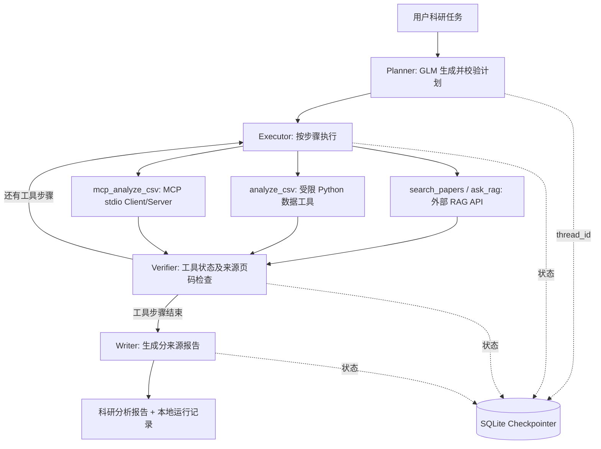

# ResearchAgent：可恢复的多工具科研分析智能体

[简体中文](README.md) | [English](README_EN.md)  
**定位：** 基于 LangGraph + MCP + SQLite 的科研任务规划、证据检索、数据分析和报告生成原型。  
**相关独立服务：** [ThermoWaste-RAG-System](https://github.com/TCJIA404/ThermoWaste-RAG-System)（通过 HTTP 提供 `/search` 与 `/ask`；文献语料不随本仓库分发）。

> 当前为求职展示与科研辅助原型，不是经独立事实核验的科研决策系统。演示 CSV 为人工构造数据；文献页码引用匹配不等于科学事实正确。

## 1. 核心能力

- **任务规划：** GLM 按白名单生成与校验结构化 JSON 计划，支持文献检索、直接 CSV 分析、MCP 分析和最终报告步骤。
- **多工具执行：** `search_papers` / `ask_rag` 调用外部 FastAPI；`analyze_csv` 完成统计/相关性/散点图；`mcp_analyze_csv` 通过真正的 MCP stdio Client/Server 调用分析工具。
- **证据检查：** 从检索包装信息提取 `(paperXX.pdf, p.N)`，阻止无引用或引用未检索页码的最终报告；**不能核实引文是否在科学上支持全部结论**。
- **SQLite 任务恢复：** 使用 LangGraph `SqliteSaver`、`thread_id` 与检查点支持已提交节点后的继续执行。并非任意崩溃场景下工具恰好执行一次。
- **科研数据边界：** 只允许合法数据集 ID、预定义分析操作和受控路径；模拟数据明确标识为 SYNTHETIC。
- **可选基础 Agent：** `research_agent.py` 保留原始 LangGraph `ToolNode`/Function Calling 实现与初步引用、主张检查。

## 2. 主工作流



**两个入口：** `planned_workflow.py` 是当前主工作流；`research_agent.py` 是早期 Function Calling 风格的对照/扩展示例。不要把它们误认为两个同时运行的生产服务。

## 3. 项目结构

```text
ResearchAgent/
├── planned_workflow.py      # 主入口：Planner → Executor → Verifier → Writer
├── planner.py               # JSON 计划生成与安全校验
├── research_agent.py        # 独立的 ToolNode / Function Calling 示例
├── data_analysis_tool.py    # 安全 CSV 统计、相关性与绘图
├── mcp_server.py            # MCP 服务端（三个工具）
├── mcp_analysis_bridge.py  # LangGraph 到 MCP 的同步桥接
├── mcp_client_demo.py       # MCP 端到端通信演示
├── day3_checkpoint_demo.py # 不用真实模型的 SQLite 恢复演示
├── agent/                  # 引用检查、主张复核与质量标记（基础 Agent 使用）
├── data/                   # 仅包含可公开的人工构造演示 CSV
├── tests/                  # 离线/模拟/本地 MCP 测试及故障注入
├── evaluation/             # 执行记录指标与报告生成
├── scripts/retry_writer.py # 引用失败时独立重试 Writer
├── docs/                   # 架构、运行、评测与发布说明
├── .env.agent.example      # 环境变量模板（无密钥）
├── .gitignore
└── requirements.txt        # 统一依赖清单
```

## 4. 在 Windows 上运行

需要 **Python 3.11**。本项目不加载 PDF 或构建 FAISS；其论文工具通过 HTTP 使用另一个正在运行的 RAG 服务。

```cmd
conda create -n thermowaste-agent python=3.11 -y
conda activate thermowaste-agent
cd /d D:\ResearchAgent
python -m pip install -r requirements.txt
copy .env.agent.example .env.agent
```

在本地 `.env.agent` 配置（**不要提交或分享密钥**）：`AGENT_API_KEY`、`AGENT_BASE_URL`、`AGENT_MODEL`、`RAG_API_URL`。请在另一终端启动 ThermoWaste-RAG-System 的 FastAPI，确认 `http://127.0.0.1:8000/health` 正常。

**基础科研 Agent：**

```cmd
python research_agent.py --question "How does gasification temperature affect hydrogen production?" --audit
```

**规划驱动的文献报告：**

```cmd
python -u planned_workflow.py --task "Compare temperature and steam-to-fuel ratio effects on hydrogen production" --save
```

**直接 CSV 分析（不走 MCP）：**

```cmd
python -u planned_workflow.py --task "Compare literature evidence with demo data, calculate correlation and draw a scatter plot" --dataset demo_gasification --save
```

**MCP + SQLite 任务暂停恢复：**

```cmd
python -u planned_workflow.py --task "Compare gasification literature with synthetic data, calculate correlation and draw a scatter plot" --dataset demo_gasification --mcp --thread-id mcp_demo_101 --pause-after-step
python planned_workflow.py --status --thread-id mcp_demo_101
python -u planned_workflow.py --resume --thread-id mcp_demo_101 --save
```

每次新建任务必须使用**没有历史状态的新 `thread_id`**。恢复时不要再传 `--task`、`--dataset` 或 `--mcp`。数据库位于被忽略的 `checkpoints/`。

**不使用 GLM 的基本检查：**

```cmd
python -m tests.test_planner
python -m tests.test_day2_integrated_workflow
python -m tests.test_day3_real_checkpoint
python -m tests.test_day3_mcp_agent
python mcp_client_demo.py
```

各测试完整列表见 [运行与测试指南](docs/RUNBOOK.md)。

## 5. 已知限制

1. **检索依赖外部 RAG API**，而原始论文未随此仓库发布；完整研究任务不能独立复现。
2. **Verifier 只验证来源/页码出现过**，不等于核验文献原文、科学机制或数值准确性。
3. **本地演示数据是人工构造的 16 行 CSV**；Pearson 相关系数不是实证结论，也不是因果关系。
4. **MCP 分析限制于 `demo_gasification`**；目前不是任意远程 MCP 服务或通用工具市场。
5. **SQLite 是任务线程状态持久化，不是跨线程长期语义记忆**。在已提交检查点后恢复，不保证网络中途失败时恰好一次执行。
6. Writer 有真实耗时 156.7 秒、61.4 秒、以及独立重试 32.1 秒等个例。项目已添加节点计时，但尚无大规模、无偏的延迟或端到端成功率基准；也未统计可靠的 Token 成本。

## 6. 进一步阅读

- [技术栈、模块与 Skills 清单](docs/MODULES_AND_SKILLS.md)
- [架构及状态设计](docs/ARCHITECTURE.md)
- [运行、测试与故障排查](docs/RUNBOOK.md)
- [整理报告与不纳入发布包的文件](docs/CLEANUP_REPORT.md)
- [Day 4 真实评测与失败案例](docs/DAY4_RESULTS.md)
- [GitHub 发布流程和敏感信息检查](docs/GITHUB_RELEASE_STEPS.md)
- [秋招面试项目讲述提纲](docs/INTERVIEW_NOTES.md)


## 7. Day 4：可靠性评测与失败恢复（2026-10-12）

最新版归档共保存 **6 份执行记录**（包含 4 份完成、2 份受阻）：4/6 有完整报告，18 次工具执行中 17 次未记录执行错误。仅看最初 4 份成功记录则为 12/12 工具调用无错误。**这不是全部尝试的任务成功率**，也不代表答案的事实正确率；引用页码匹配只检查来源标识。

此外保留两条真实失败案例：RAG 服务未启动时状态为 `NO_EVIDENCE`；RAG 与 MCP 成功但 Writer 未按要求生成页码引用时状态为 `BLOCKED_UNCITED_ANSWER`。后者使用独立脚本 `scripts/retry_writer.py` 从已保存执行记录复用证据、只重试 Writer，最终通过来源页码匹配；原失败记录未被覆盖。三类模拟故障（RAG、MCP、Writer 超时）的离线测试也通过。

一条真实 Writer 受阻记录的节点计时：Planner 14.39 s、Executor 6.18 s、Verifier 0.059 ms、Writer 61.43 s。**仅为一条记录，计时为已完成节点耗时，不等于全部尝试耗时或整体墙钟时间。**

```cmd
python -m tests.test_day4_metrics
python -m tests.test_day4_fault_injection
python -m tests.test_day4_timing
python -m tests.test_day4_writer_retry
python -m evaluation.trace_metrics --input outputs --output-dir eval_outputs
```

详细分母、科学边界与失败案例见 [Day 4 结果说明](docs/DAY4_RESULTS.md)。公开仓库不包含私密执行日志、SQLite 数据库、API Key 和未经授权的文献全文。
